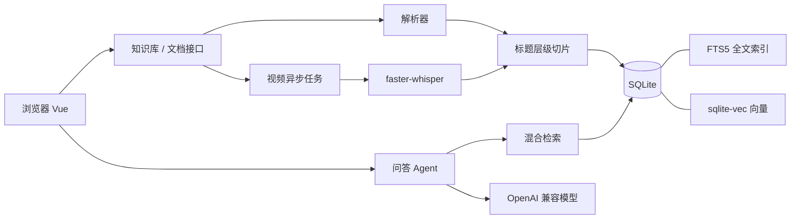

# DocInsight Agent

把 PDF / Word / Markdown / TXT / 视频变成可以提问、可以溯源的知识库。单机运行，一个 SQLite 文件同时承担存储、全文索引和向量检索，不需要额外部署数据库或向量服务。


## 30 秒跑起来

```bash
git clone https://github.com/YeYirp/docinsight-agent.git
cd docinsight-agent
./mvnw spring-boot:run          # Windows 用 .\mvnw.cmd spring-boot:run
```

打开 <http://127.0.0.1:8080>，新建知识库，把 `sample/示例产品手册.md` 拖进去，然后问「备份多久做一次」。

**不配置任何模型 Key 也能用。** 此时走抽取式回答，直接摘录检索到的原文；关键词检索、引用溯源、SSE 流式和知识库管理全部可用。配上 Key 后自动切换为模型生成：

```bash
export LLM_API_KEY=sk-xxx        # Windows: $env:LLM_API_KEY="sk-xxx"
export EMBEDDING_API_KEY=sk-xxx  # 不配则只做关键词检索
```

要求：Java 21（自带 Maven Wrapper）；不要求安装 SQLite；视频功能另需 Python 3.10+ 与 faster-whisper。
随包只带 Windows x86_64 的 sqlite-vec 扩展，macOS / Linux 首次启动前需设置 `SQLITE_VEC_EXTENSION` 指向本机 vec0 动态库，否则数据源初始化失败。

## 能力速览

| | |
| --- | --- |
| 解析 | PDF 逐页提取并保留页码；DOCX 按段落样式识别标题；Markdown / TXT 按行解析；先落盘原件再从磁盘解析，不把整份文件留在内存 |
| 切片 | 按标题层级切分，保留章节路径与页码 / 段落 / 视频时间位置 |
| 检索 | vec0 向量召回 + FTS5 关键词召回加权融合；向量服务不可用时自动降级为关键词检索 |
| 回答 | SSE 依次返回阶段进度、引用来源、增量文本，同时记录耗时与 Token |
| 溯源 | 回答下方每条引用可展开原文片段与定位 |
| 文件 | 点击文件名查看原件；MD / TXT 在线编辑并自动重建索引；PDF 内嵌预览、Word 分节展示、视频拖动播放 |
| 视频 | MP4 / MOV / MKV / WEBM / AVI / M4V，本地 faster-whisper 转写为带时间戳切片，异步任务上报进度 |
| 知识库 | 新建、改名与描述、原文件目录管理、删除、搜索、排序、列表与画廊视图、一次最多勾选 20 个库联合问答 |

限制：文档单文件 50MB（应用内校验），multipart 请求上限 512MB（`MAX_UPLOAD_SIZE`），视频默认 500MB / 120 分钟。
直接双击 `src/main/resources/static/index.html` 会进入离线预览模式，只保留对话页且不发起后端请求，不能提问。

## 怎么工作的



一次问答：问题关键词提取 → 混合检索 → 必要时调用工具（限轮次）→ 流式生成 → 回传引用。
检索侧的动态 SQL（范围过滤、打分表达式、FTS / LIKE 召回、KNN）由 MyBatis 承载，批量写入走 JDBC。

## 配置

`.env` 不会被 Spring Boot 自动读取：本机用环境变量或 IDE 运行配置，Docker 用 compose 的 `env_file`。
下面是常改的几项，完整清单见 [`.env.example`](.env.example) 与 [`application.yml`](src/main/resources/application.yml)。

| 变量 | 默认值 | 说明 |
| --- | --- | --- |
| `SERVER_PORT` | `8080` | 服务端口 |
| `LLM_BASE_URL` / `LLM_API_KEY` / `LLM_MODEL` | DeepSeek / 空 / `deepseek-chat` | OpenAI 兼容网关；Key 为空走抽取式回答 |
| `EMBEDDING_BASE_URL` / `EMBEDDING_API_KEY` / `EMBEDDING_MODEL` | SiliconFlow / 空 / `BAAI/bge-m3` | Key 为空只做关键词检索 |
| `EMBEDDING_DIMENSION` | `1024` | 必须与 `chunk_vector` 表维度一致 |
| `RAG_TOP_K` / `RAG_CHUNK_SIZE` / `RAG_CHUNK_OVERLAP` | `4` / `600` / `80` | 返回块数与切片长度 |
| `DATABASE_URL` | `jdbc:sqlite:./data/docinsight.db` | SQLite 文件 |
| `SOURCEFILES_ROOT` | `./data/sourcefiles` | 原文件根目录，每个知识库一个子目录 |
| `MAX_UPLOAD_SIZE` | `512MB` | multipart 上限 |
| `VIDEO_ENABLED` / `VIDEO_WHISPER_MODEL` | `true` / `small` | 视频摄取开关与模型 |

## 数据放在哪

```text
data/
├── docinsight.db     知识库、切片、FTS5 索引、向量
├── sourcefiles/      每个知识库一个目录，放文档与视频原件
├── models/           Whisper 模型缓存
└── native/           sqlite-vec 运行时释放文件
```

`data/` 已在 `.gitignore` 中，备份整个目录即可。视频原件和 Whisper 模型不写入数据库；启用 Embedding 后向量通常比正文更占空间。
知识库可以单独改原文件目录（应用内文件夹浏览器选择，不可手输路径），全局根目录由 `SOURCEFILES_ROOT` 决定。

## 视频转写

```bash
python -m pip install -r scripts/video-requirements.txt   # 已固定 faster-whisper 1.2.1 + PyAV 16.0.1
```

首次处理会下载模型（默认 `small`、CPU `int8`、缓存在 `data/models`；国内可设 `VIDEO_HF_ENDPOINT=https://hf-mirror.com`），worker 空闲 10 分钟后释放模型内存。
上传视频返回 `202`，任务状态 `QUEUED → PROCESSING → DONE / FAILED`，前端轮询 `/api/ingestion-jobs/{id}` 显示进度。
两点已知边界：任务状态只存在当前进程内存里，重启后未完成任务的查询状态丢失（已入库文档不受影响）；当前只做语音转写，画面文字与场景识别未启用。

## 接口

| 方法 | 路径 |
| --- | --- |
| `POST` | `/api/ask` — SSE 问答，body 为 `question`、`knowledgeBaseIds`（最多 20 个） |
| `GET` | `/api/health`、`/api/metrics` — 健康检查与请求数 / 错误数 / 工具调用 / Token / 平均耗时 |
| `GET` `POST` `PUT` `DELETE` | `/api/knowledge-bases`、`/api/knowledge-bases/{id}` — 知识库增删改查 |
| `GET` `POST` | `/api/knowledge-bases/{id}/documents` — 文档列表与上传（multipart 字段名 `file`） |
| `GET` `PUT` `DELETE` | `/api/docs/{id}`、`/content`、`/source`、`/media` — 文档、在线编辑、原件与视频流（支持 Range） |
| `GET` | `/api/ingestion-jobs/{id}`、`/api/settings/directories` — 转写任务与目录浏览 |

<details>
<summary>请求与响应示例</summary>

```json
// POST /api/ask
{ "question": "备份多久做一次？", "sessionId": "demo", "knowledgeBaseIds": ["kb-1", "kb-2"] }

// SSE event: sources
[{ "index": 1, "docName": "示例产品手册.md",
   "heading": "6. 数据备份与恢复 > 6.1 备份策略",
   "location": "第 3 页", "snippet": "系统默认每日凌晨 2 点执行一次全量备份…",
   "score": 0.82 }]

// 视频上传返回 202
{ "async": true, "jobId": "job-1", "docId": "doc-1",
  "name": "demo.mp4", "status": "QUEUED", "stage": "等待处理" }
```

</details>

## 开发

```bash
./mvnw test                                     # 后端：解析、入库、检索、持久化、端到端问答
node --test src/test/js/doc-utils.test.js       # 前端工具函数（Node 仅用于测试，运行不需要）
```

```text
src/main/java/com/example/docinsight
├── config      SQLite 数据源与 schema、vec0 扩展加载、AI 与视频配置
├── controller  知识库、文档、问答、目录浏览、统一异常处理
├── mapper      MyBatis 检索查询（动态 SQL 在同名 XML 里）
├── model       知识库、文档、切片、入参
└── service     解析 → 切片 → 存储 → 检索 → Agent 生成 → 视频转写
src/main/resources/static/   单文件 Vue 应用（vendor/ 与 js/ 必须同目录）
src/main/resources/python/   faster-whisper worker
```

## 设计取舍

- **按标题切分而非固定长度**：固定窗口会把标题和上一节内容切到一起，按标题保留章节语义，引用定位也更准。
- **向量不可用就降级**：向量是增强项，Embedding 失败时退回 FTS5 关键词召回，核心问答不断。
- **视频不进数据库**：二进制会让 SQLite 迅速膨胀，原件放磁盘，库里只存转写文本和时间戳。
- **工具调用限轮次**：模型可能反复调用工具不收敛，用轮次、超时和 Token 上限控制成本与延迟。
- `webSearch` 目前是离线示例实现（`Tools.mockSearch`），接真实搜索只需替换该方法。

## 隐私

密钥只从环境变量注入，仓库不含 Key；文档原件、SQLite 数据、Whisper 模型和转写结果都留在本地 `data/`；视频语音由本地 faster-whisper 处理。
联网只发生在你配置的调用里：启用 Embedding 时切片文本发往 Embedding 服务，启用 LLM 时问题与检索上下文发往模型网关；`webSearch` 不访问互联网。示例文档为虚构内容。

## License

MIT。前端 Vue 3、sqlite-vec、faster-whisper、PDFBox、Apache POI、LangChain4j 均按各自开源协议使用。
