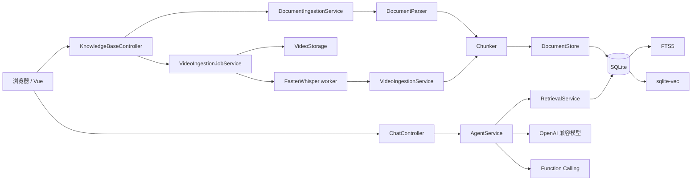

# DocInsight Agent

面向企业资料的本地知识问答 Agent。支持 PDF、Word、Markdown、TXT 和常见视频格式，
文档按标题层级切分，视频通过 faster-whisper 转写为带时间戳的文本切片，再经过混合检索、
流式生成和引用溯源返回答案。


## 功能

- **文档解析**：PDF 逐页提取并保留页码；DOCX 按段落样式识别标题；Markdown/TXT 按行解析。
- **视频知识库**：支持 MP4、MOV、MKV、WEBM、AVI、M4V，自动提取语音、生成时间戳切片，
  支持在浏览器中拖动播放。
- **结构化切片**：按标题层级把内容切成 Chunk，保留章节路径、页码、段落或视频时间位置。
- **混合检索**：向量召回 + FTS5 关键词召回，按权重融合；向量服务不可用时自动降级为关键词检索。
- **本地持久化**：SQLite 保存知识库、文档元数据、文本切片、FTS5 索引和向量；
  视频原文件和 Whisper 模型不写入数据库。
- **引用溯源**：回答关联具体 Chunk，前端可以展开查看原文片段和章节/页码/时间位置。
- **文件查看**：点击知识库中的文件名即可查看原件；PDF 内嵌预览、文本显示原文、
  Word 展示解析后的分节内容、视频直接播放，不提供原文件编辑。
- **流式回答**：SSE 返回阶段进度、引用来源和增量文本，同时记录耗时与 Token。
- **知识库工作区**：支持新建、编辑名称和描述、删除、搜索、排序、文档/画廊视图和多知识库问答。
- **运行监控**：提供 `/api/health` 和 `/api/metrics`。

## 架构



一次问答顺序：问题关键词提取 → 混合检索 → 必要时调用工具 → 流式生成 → 回传引用。

## 环境要求

- Java 21
- 项目自带 Maven Wrapper
- 视频功能额外需要 Python 3.10+ 和 faster-whisper
- 不要求单独安装 SQLite 数据库

## 快速开始

```powershell
git clone https://github.com/YeYirp/docinsight-agent.git
cd docinsight-agent
.\mvnw.cmd spring-boot:run
```

Linux / macOS：

```bash
./mvnw spring-boot:run
```

启动后访问：

```text
http://127.0.0.1:8080
```

不要直接双击 `src/main/resources/static/index.html`。该页面依赖 Spring Boot 提供接口和
静态资源，直接以 `file://` 打开时页面会提示先启动应用。

使用步骤：

1. 打开「知识库」，在右上角新建知识库。
2. 上传文档或视频。
3. 普通文档会立即解析；视频会创建异步任务，页面显示转写状态。
4. 在「新对话」中勾选一个或多个知识库后提问。
5. 点击回答下方的引用项查看原文片段、页码或视频时间位置。

普通文档单文件上限为 50MB；视频默认上限为 500MB、120 分钟。

不配置任何模型 Key 也可以运行。此时使用抽取式回答，直接摘录检索到的原文；
关键词检索、引用、SSE 和知识库管理仍然可用。

## 视频知识库

安装视频转写依赖：

```powershell
python -m pip install -r scripts/video-requirements.txt
```

依赖版本已经固定为 faster-whisper `1.2.1` 和 PyAV `16.0.1`，避免当前版本组合的兼容问题。

首次处理视频会下载 Whisper 模型。默认配置是：

- 模型：`small`
- 计算设备：`auto`
- CPU 计算类型：`int8`
- 模型缓存：`data/models`
- 视频文件：`data/media`
- worker 空闲 10 分钟后释放模型内存

国内网络可设置：

```powershell
$env:VIDEO_HF_ENDPOINT="https://hf-mirror.com"
```

视频处理采用异步任务：

```text
QUEUED -> PROCESSING -> DONE
                     \-> FAILED
```

原视频保存在磁盘，SQLite 只保存文件名、时长和转写切片。当前视频分析范围是语音转写；
幻灯片、界面文字和画面场景识别尚未默认启用，可后续接入 PySceneDetect 和 OCR。

异步任务状态保存在当前进程内存中。应用重启后，未完成任务的查询状态会丢失，
但已经入库的文档和已生成切片不受影响。

## 数据存放

默认数据目录：

```text
data/
├── docinsight.db       SQLite：知识库、切片、FTS5、向量
├── documents/          普通文档原件
├── media/              视频原文件
├── models/             Whisper 模型缓存
└── native/             sqlite-vec 等运行时释放文件
```

`data/` 已加入 `.gitignore`。备份时复制整个 `data/` 目录即可。旧版本上传的文档没有原件时，
文件查看页会回退展示已解析的索引文本。

数据库体积主要取决于切片数量和向量数量。视频原文件不进入 SQLite；启用 Embedding 后，
向量通常会比文本本身占用更多空间。

## 性能与资源

- SQLite 使用 HikariCP 复用连接，`vec0` 扩展只在物理连接建立时加载。
- 切片和向量写入使用批量 JDBC。
- Embedding 默认每 32 条一批发送，缺失向量分批生成和写回。
- FTS5 使用 contentless 索引，不重复保存切片正文和 ID。
- PDF / DOCX / 文本直接从上传流解析，避免额外保留完整文件副本。
- Web 线程默认限制为 32，可通过环境变量调整。
- Whisper worker 空闲后释放模型内存，下一次视频按需重新加载。
- 旧数据库首次启动会自动重建一次 FTS 索引，之后不会重复重建。

## 配置

`.env` 不会被 Spring Boot 自动读取。Windows / IDE 请使用运行配置或系统环境变量；
Docker 可以使用 compose 的 `env_file`。

| 环境变量 | 默认值 | 说明 |
| --- | --- | --- |
| `SERVER_PORT` | `8080` | 服务端口 |
| `TOMCAT_MAX_THREADS` | `32` | Web 最大工作线程 |
| `TOMCAT_MIN_SPARE_THREADS` | `4` | Web 最小空闲线程 |
| `MAX_UPLOAD_SIZE` | `512MB` | multipart 最大请求大小 |
| `LLM_BASE_URL` | `https://api.deepseek.com/v1` | OpenAI 兼容 LLM 网关 |
| `LLM_API_KEY` | 空 | 不填则使用抽取式回答 |
| `LLM_MODEL` | `deepseek-chat` | LLM 模型名 |
| `LLM_TIMEOUT_SECONDS` | `120` | 单次 LLM 调用超时 |
| `MAX_TOOL_ROUNDS` | `3` | 工具调用最大轮次 |
| `EMBEDDING_BASE_URL` | `https://api.siliconflow.cn/v1` | Embedding 服务地址 |
| `EMBEDDING_API_KEY` | 空 | 不填则只做关键词检索 |
| `EMBEDDING_MODEL` | `BAAI/bge-m3` | 向量模型 |
| `EMBEDDING_DIMENSION` | `1024` | 向量维度，必须和 `chunk_vector` 一致 |
| `EMBEDDING_BATCH_SIZE` | `32` | 单次 Embedding 最大文本条数 |
| `DATABASE_URL` | `jdbc:sqlite:./data/docinsight.db` | SQLite 文件路径 |
| `DOCUMENT_STORAGE_DIR` | `./data/documents` | 普通文档原件目录 |
| `SQLITE_VEC_EXTENSION` | 空 | 可选外部 sqlite-vec 扩展路径 |
| `DB_POOL_SIZE` | `4` | SQLite 连接池上限 |
| `RAG_TOP_K` | `4` | 最终返回块数 |
| `RAG_CHUNK_SIZE` | `600` | 单个 Chunk 最大字符数 |
| `RAG_CHUNK_OVERLAP` | `80` | Chunk 重叠字符数 |
| `VIDEO_ENABLED` | `true` | 是否启用视频摄取 |
| `VIDEO_PYTHON_COMMAND` | 自动查找 | Python 可执行文件，例如 `python` |
| `VIDEO_WHISPER_MODEL` | `small` | 模型名或本地 faster-whisper 模型目录 |
| `VIDEO_WHISPER_DEVICE` | `auto` | `auto` / `cpu` / `cuda` |
| `VIDEO_WHISPER_COMPUTE_TYPE` | `int8` | CPU 用 `int8`，GPU 可用 `float16` |
| `VIDEO_WHISPER_LANGUAGE` | `auto` | 转写语言，中文可填 `zh` |
| `VIDEO_HF_ENDPOINT` | 空 | Hugging Face 模型下载镜像 |
| `VIDEO_MAX_SIZE_MB` | `500` | 单个视频大小上限 |
| `VIDEO_MAX_DURATION_MINUTES` | `120` | 单个视频时长上限 |
| `VIDEO_STORAGE_DIR` | `./data/media` | 视频原文件目录 |
| `VIDEO_MODEL_DIR` | `./data/models` | Whisper 模型缓存目录 |
| `VIDEO_STARTUP_TIMEOUT_SECONDS` | `600` | worker 启动/模型加载超时 |
| `VIDEO_TRANSCRIBE_TIMEOUT_MINUTES` | `120` | 单次视频转写超时 |
| `VIDEO_WORKER_IDLE_MINUTES` | `10` | worker 空闲释放时间，0 表示常驻 |

接入 LLM：

```powershell
$env:LLM_API_KEY="sk-xxx"
.\mvnw.cmd spring-boot:run
```

启用向量检索：

```powershell
$env:EMBEDDING_API_KEY="sk-xxx"
```

## API

| 方法 | 路径 | 说明 |
| --- | --- | --- |
| `GET` | `/api/knowledge-bases` | 知识库列表 |
| `POST` | `/api/knowledge-bases` | 新建知识库，JSON 字段 `name`、`description` |
| `PUT` | `/api/knowledge-bases/{id}` | 修改知识库名称和描述 |
| `GET` | `/api/knowledge-bases/{id}` | 知识库详情 |
| `DELETE` | `/api/knowledge-bases/{id}` | 删除知识库、文档、索引和视频文件 |
| `GET` | `/api/knowledge-bases/{id}/documents` | 知识库文档列表 |
| `POST` | `/api/knowledge-bases/{id}/documents` | 上传文档或视频，multipart 字段名 `file` |
| `POST` | `/api/docs/upload` | 上传独立文档或视频，multipart 字段名 `file` |
| `GET` | `/api/docs` | 全部文档列表 |
| `DELETE` | `/api/docs/{id}` | 删除文档、索引和对应视频文件 |
| `GET` | `/api/docs/{id}/media` | 视频播放，支持 HTTP Range |
| `GET` | `/api/docs/{id}/content` | 文件查看页所需的内容结构 |
| `GET` | `/api/docs/{id}/source` | 普通文档原件，支持 HTTP Range |
| `GET` | `/api/ingestion-jobs/{id}` | 查询异步视频转写任务 |
| `POST` | `/api/ask` | SSE 问答 |
| `GET` | `/api/health` | 服务与数据库健康检查 |
| `GET` | `/api/metrics` | 请求数、错误数、工具调用、Token 和平均耗时 |

视频上传会返回 `202 Accepted`：

```json
{
  "async": true,
  "jobId": "任务-id",
  "docId": "文档-id",
  "name": "demo.mp4",
  "status": "QUEUED",
  "stage": "等待处理"
}
```

查询任务：

```text
GET /api/ingestion-jobs/{jobId}
```

问答请求：

```json
{
  "question": "备份多久做一次？",
  "sessionId": "demo-session",
  "knowledgeBaseIds": ["知识库-id-1", "知识库-id-2"]
}
```

`sources` 事件示例：

```json
[
  {
    "index": 1,
    "docName": "示例产品手册.md",
    "heading": "6. 数据备份与恢复 > 6.1 备份策略",
    "location": "第 3 页",
    "snippet": "系统默认每日凌晨 2 点执行一次全量备份…",
    "score": 0.82
  }
]
```

## 项目结构

```text
src/main/java/com/example/docinsight
├── DocInsightApplication.java
├── config/
│   ├── AiProperties / AiConfig
│   ├── VideoProperties
│   ├── DatabaseConfig / SqliteDataSource
│   └── SqliteSchema / SqliteExtensionLoader
├── controller/
│   ├── KnowledgeBaseController
│   ├── DocumentController
│   ├── IngestionJobController
│   ├── ChatController
│   └── ApiExceptionHandler
├── model/
│   ├── KnowledgeBase / DocumentInfo / Chunk / AskInput
│   ├── DocumentContentView / UpdateKnowledgeBaseInput
│   └── VideoIngestionJob
└── service/
    ├── DocumentParser / Chunker / DocumentFormat
    ├── DocumentIngestionService
    ├── DocumentSourceStorage / DocumentViewService
    ├── DocumentStore
    ├── EmbeddingClient / RetrievalService
    ├── Tools / AgentService / MetricsService
    ├── VideoTranscriber / VideoTranscript
    ├── FasterWhisperTranscriber
    ├── VideoStorage / VideoIngestionService
    └── VideoIngestionJobService

src/main/resources
├── static/
├── schema.sql
├── application.yml
└── python/faster_whisper_worker.py

scripts/video-requirements.txt
```

## 设计取舍

**为什么按标题切分？**

固定长度容易把标题和上一节内容切在一起。按标题切分能保留章节语义，并让引用定位更准确。

**为什么向量服务失败要降级？**

向量检索是增强项。Embedding 不可用时自动退回 FTS5 关键词检索，核心问答仍可用。

**为什么视频不写入数据库？**

视频二进制会让 SQLite 迅速膨胀。原文件放磁盘，数据库只保存转写文本和时间戳切片，
备份和清理也更清晰。

**为什么工具调用限轮次？**

模型可能反复调用工具不收敛。当前通过轮次、超时和 Token 上限控制成本和延迟。

`webSearch` 目前是离线示例实现，位于 `Tools.mockSearch`。接入真实搜索服务时只需替换该实现。

## 测试

```powershell
.\mvnw.cmd test
node --test src/test/js/doc-utils.test.js
```

Node.js 只用于前端工具函数测试，不是运行应用的必需项。

## 隐私说明

- 仓库不包含 API Key，密钥通过环境变量注入。
- 视频原文件、SQLite 数据和 Whisper 模型默认保存在本地 `data/`。
- 视频语音由本地 faster-whisper 处理。
- 启用 Embedding 时，切片文本会发送到配置的 Embedding 服务。
- 启用 LLM 时，问题和检索上下文会发送到配置的模型网关。
- 当前 `webSearch` 为离线示例，不会主动访问互联网。
- 示例文档为虚构内容。

## License

MIT。`src/main/resources/static/vendor/vue.global.prod.js` 来自 Vue 3（MIT）。
