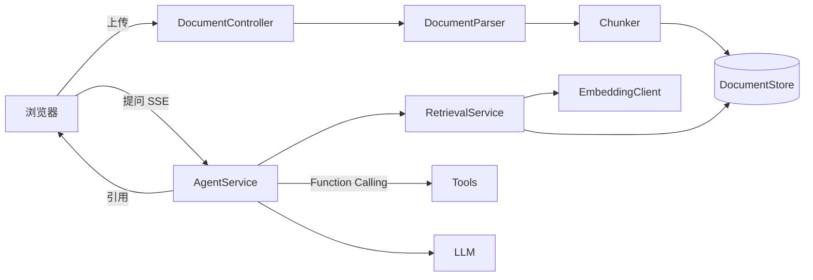

# DocInsight Agent

企业文档知识问答 Agent：上传 PDF / Word 手册，按标题层级切分入库，混合检索后流式作答，
每条结论都能点回原文位置。


## 特性

- **文档解析**：PDF 逐页提取并保留页码，Word 按段落样式识别标题，Markdown/TXT 直接按行解析。
- **结构化切分**：按标题层级切 Chunk，保留「文档 → 章节路径 → 页码/段落」元数据，
  避免知识点被截断。
- **混合检索**：BGE-M3 向量召回 + 关键词召回，按 0.6 / 0.25 / 0.15 加权融合；
  向量服务不可用时自动降级为纯关键词。
- **引用溯源**：回答强制关联原文 Chunk，前端点开即看片段与位置，可核对。
- **工具调用**：文档里没有答案时可调用联网搜索工具，限制最大轮次，超限禁用工具强制总结。
- **流式交互**：SSE 推送阶段进度与增量文本，同时记录耗时与 Token。
- **检索评测**：内置评测集，`/api/eval` 直接返回 Hit Rate@K，便于调参。

## 架构



一次问答的顺序：关键词提取 → 混合检索 →（必要时）工具调用 → 流式生成 + 引用回传。

## 快速开始

```bash
git clone https://github.com/<your-name>/docinsight-agent.git
cd docinsight-agent
./mvnw spring-boot:run          # Windows: mvnw.cmd spring-boot:run
```

打开 http://localhost:8080 ，上传 `sample/示例产品手册.md`，然后提问「备份多久做一次？」。

**不配置任何 Key 也能跑**：此时使用抽取式回答（直接摘录检索到的原文），
检索、引用、SSE、评测全部可用，适合先看效果。

接入模型：

```powershell
$env:LLM_API_KEY="sk-xxx"
./mvnw.cmd spring-boot:run
```

想要向量检索，再配一组 Embedding（任意 OpenAI 兼容的 `/embeddings` 服务）：

```powershell
$env:EMBEDDING_API_KEY="sk-xxx"
```

## 配置

| 环境变量 | 默认值 | 说明 |
| --- | --- | --- |
| `SERVER_PORT` | `8080` | 服务端口 |
| `LLM_BASE_URL` | `https://api.deepseek.com/v1` | OpenAI 兼容网关 |
| `LLM_API_KEY` | 空 | 不填则走抽取式回答 |
| `LLM_MODEL` | `deepseek-chat` | 模型名 |
| `LLM_TIMEOUT_SECONDS` | `120` | 单次调用超时 |
| `MAX_TOOL_ROUNDS` | `3` | 工具调用最大轮次 |
| `EMBEDDING_API_KEY` | 空 | 不填则只做关键词检索 |
| `EMBEDDING_BASE_URL` | `https://api.siliconflow.cn/v1` | Embedding 服务地址 |
| `EMBEDDING_MODEL` | `BAAI/bge-m3` | 向量模型 |
| `RAG_TOP_K` | `4` | 检索返回块数 |

## API

| 方法 | 路径 | 说明 |
| --- | --- | --- |
| `POST` | `/api/docs/upload` | 上传 PDF / DOCX / MD / TXT（multipart，字段名 `file`） |
| `GET` | `/api/docs` | 文档列表 |
| `DELETE` | `/api/docs/{id}` | 删除文档及其索引 |
| `POST` | `/api/ask` | SSE 问答，事件：`stage` / `sources` / `delta` / `done` / `error` |
| `GET` | `/api/eval?topK=3` | 检索评测，返回 Hit Rate 与逐题明细 |
| `GET` | `/api/health` | 健康检查 |
| `GET` | `/api/metrics` | 请求数、Token、平均耗时 |

`sources` 事件示例：

```json
[{"index":1,"docName":"示例产品手册.md","heading":"6. 数据备份与恢复 > 6.1 备份策略",
  "location":"第 3 页","snippet":"系统默认每日凌晨 2 点执行一次全量备份…","score":0.82}]
```

## 评测

内置 12 条业务问题（`src/main/resources/eval/questions.json`），每条给出期望关键词，
TopK 中任意一块命中即算召回：

```bash
curl "http://localhost:8080/api/eval?topK=3"
```

返回 `hitRate`、`hits`、`cases` 与逐题明细。想扩到 50+ 题，直接往 JSON 里加即可；
建议按文档章节均匀取样，覆盖「定义类、流程类、故障类」三种问法。

> 说明：这里只评测检索层（Hit Rate@K）。生成层指标（忠实度）需要人工或模型打分，
> 本仓库不内置，避免给出没有依据的数字。

## 项目结构

```
src/main/java/com/example/docinsight
├── DocInsightApplication.java
├── config/           AiProperties、AiConfig（同步模型 + 流式模型）
├── controller/       DocumentController、ChatController
├── model/            Chunk、DocumentInfo、AskInput
└── service/
    ├── DocumentParser    PDF/Word/文本 → 块（含标题层级、页码）
    ├── Chunker           按标题切 Chunk（含重叠）
    ├── DocumentStore     内存文档库
    ├── EmbeddingClient   向量化（可选）
    ├── RetrievalService  混合检索与融合
    ├── Tools             Function Calling 工具
    ├── AgentService      编排 + SSE + 引用
    └── EvalService       Hit Rate@K
```

## 设计取舍

**为什么按标题切，而不是固定长度切？**
固定长度会把「备份策略」的标题和上一节内容切在一起，检索命中后用户看到的是半截话。
按标题切能保证每个 Chunk 语义完整，同时保留章节路径，引用时可定位。

**为什么检索失败要降级？**
检索是增强手段，不是必须项。向量服务挂了就退化为关键词，用户至少还能拿到答案。

**为什么工具要限轮次？**
模型可能反复搜索不收敛。轮次 + 超时 + Token 三重上限，到限就禁用工具强制总结。

**为什么引用要精确到页码？**
企业文档问答的核心是「可核对」。只给文档名，用户还要自己翻；给到章节 + 页码，
点开就能验证，信任成本低得多。

## 隐私说明

- 仓库内**不包含任何 API Key**，全部通过环境变量注入，`.env` 已被 `.gitignore` 排除。
- 上传的文档只存在内存中，重启即清空，不会落盘、不会外传（除非你配置了外部 Embedding 服务）。
- 示例文档为虚构内容，不含真实企业信息。

## License

MIT。`src/main/resources/static/vendor/vue.global.prod.js` 来自 Vue 3（MIT）。
