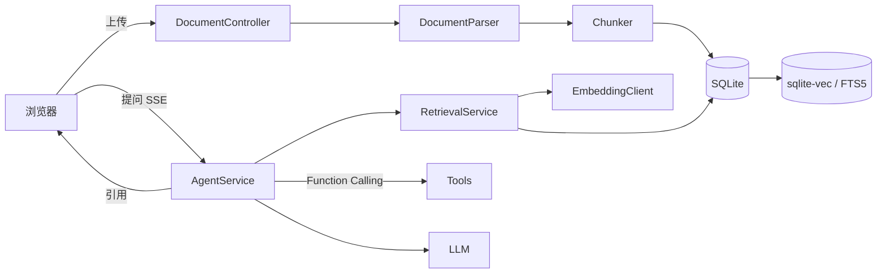

# DocInsight Agent

企业文档知识问答 Agent：上传 PDF / Word 手册，按标题层级切分入库，混合检索后流式作答，
每条结论都能点回原文位置。


## 特性

- **文档解析**：PDF 逐页提取并保留页码，Word 按段落样式识别标题，Markdown/TXT 直接按行解析。
- **视频知识库**：上传 MP4 / MOV / MKV / WEBM / AVI / M4V，使用 faster-whisper 转写为带时间戳的
  文本切片；视频原文件保存在磁盘，SQLite 只保存转写内容和少量元数据。
- **结构化切分**：按标题层级切 Chunk，保留「文档 → 章节路径 → 页码/段落」元数据，
  避免知识点被截断。
- **混合检索**：BGE-M3 向量召回 + 关键词召回，按 0.6 / 0.25 / 0.15 加权融合；
  向量服务不可用时自动降级为纯关键词。
- **本地持久化**：SQLite 单文件保存知识库、文档、切片与向量；关键词使用 FTS5，
  向量检索使用随应用打包的 `sqlite-vec`，无需另装数据库或扩展。
- **引用溯源**：回答强制关联原文 Chunk，前端点开即看片段与位置，可核对。
- **工具调用**：文档里没有答案时可调用联网搜索工具，限制最大轮次，超限禁用工具强制总结。
- **流式交互**：SSE 推送阶段进度与增量文本，同时记录耗时与 Token。
- **知识库工作区**：左侧只有「新对话」「知识库」两个主模块；知识库支持新建、添加/删除文档，
  提问时可以选择一个或多个知识库作为检索范围。

## 架构



一次问答的顺序：关键词提取 → 混合检索 →（必要时）工具调用 → 流式生成 + 引用回传。

## 快速开始

```bash
git clone https://github.com/YeYirp/docinsight-agent.git
cd docinsight-agent
./mvnw spring-boot:run          # Windows: mvnw.cmd spring-boot:run
```

项目需要 Java 21。Windows PowerShell 也可以直接运行：

```powershell
.\mvnw.cmd spring-boot:run
```

打开 http://127.0.0.1:8080 ，默认进入「新对话」；在「知识库」中新建知识库、
上传 `sample/示例产品手册.md` 后，即可在对话中勾选知识库并提问。

> **数据保存位置：** 所有知识库元数据、文档、切片、FTS5 索引和向量都保存在
> `./data/docinsight.db`。首次启动会自动创建 `data` 目录、SQLite 表和 vec0 扩展。
> 重启不会丢失数据；删除整个软件目录时，`data` 也会一起删除。

`vec0.dll`（sqlite-vec 0.1.9 Windows x64）已放在
`src/main/resources/native/windows-x86_64/` 并会打包进应用。程序启动时将其释放到
`./data/native/windows-x86_64/`，每条 SQLite JDBC 连接都会自动执行
`load_extension(...)`，用户无需手工注册扩展。

**不配置任何 Key 也能跑**：此时使用抽取式回答（直接摘录检索到的原文），
检索、引用、SSE、评测全部可用，适合先看效果。

接入模型：

```powershell
$env:LLM_API_KEY="sk-xxx"
./mvnw.cmd spring-boot:run
```

想要向量检索，再配一组 Embedding（任意 OpenAI 兼容的 `/embeddings` 服务）：

```powershell
$env:EMBEDDING_API_KEY="sk-xxx"
```

## 视频知识库

视频摄取使用成熟开源组件：[faster-whisper](https://github.com/SYSTRAN/faster-whisper)
做语音识别，模型常驻 worker，视频按单线程队列处理。需要 Python 3.10+：

```powershell
python -m pip install -r scripts/video-requirements.txt
```

首次处理视频时会下载 Whisper 模型。默认使用 `small` + CPU `int8`，兼顾中文效果和资源占用；
也可以改成 `base` 降低占用，或配置 `cuda`/`float16` 提高速度。若更偏好纯 C++ 部署，可参考
[whisper.cpp](https://github.com/ggml-org/whisper.cpp)，接口层已与具体转写器解耦。
国内网络可设置 `VIDEO_HF_ENDPOINT=https://hf-mirror.com`，或直接使用本地的
`VIDEO_WHISPER_MODEL` 模型目录。

当前视频分析的范围是**语音转写 + 时间戳切片**：

- 视频原文件保存到 `data/media/`，不会以 BLOB 形式写入 SQLite；
- SQLite 中只增加文件名、时长和转写 Chunk，通常每条视频只占几 KB 到几 MB 文本；
- 转写片段沿用现有混合检索和引用溯源，引用位置显示 `00:01:23` 这样的时间；
- 单线程任务队列避免多个 Whisper 转写同时抢占 CPU，模型只加载一次；
- 上传接口快速返回任务 ID，页面轮询转写状态，不会把长视频转写卡在一个 HTTP 请求里；
- 可选视觉层可以参考 [PySceneDetect](https://github.com/Breakthrough/PySceneDetect)
  做镜头切片，再接入 OCR；当前版本默认只处理语音，避免默认引入重型视觉模型。

如果视频没有语音，当前版本会明确报错。需要识别幻灯片、界面文字或画面内容时，再在
`VideoTranscriber` 之后增加关键帧 OCR 管线即可。

## 性能与资源

- SQLite 使用 HikariCP 复用连接，`vec0` 扩展只在物理连接建立时加载一次；
- 切片和向量写入使用批量 JDBC，避免逐条查询 `rowid` 和逐条往返；
- Embedding 默认按 32 条一批发送，缺失向量按批生成、写回；
- FTS5 使用 contentless 索引，不再在 FTS 表里重复保存切片正文和 ID；
- PDF / DOCX / 文本从上传流直接解析，少保留一份完整文件副本；
- 视频模型 worker 空闲 10 分钟后释放模型内存，下一次视频再按需加载。

## 配置

| 环境变量 | 默认值 | 说明 |
| --- | --- | --- |
| `SERVER_PORT` | `8080` | 服务端口 |
| `LLM_BASE_URL` | `https://api.deepseek.com/v1` | OpenAI 兼容网关 |
| `LLM_API_KEY` | 空 | 不填则走抽取式回答 |
| `LLM_MODEL` | `deepseek-chat` | 模型名 |
| `LLM_TIMEOUT_SECONDS` | `120` | 单次调用超时 |
| `MAX_TOOL_ROUNDS` | `3` | 工具调用最大轮次 |
| `EMBEDDING_API_KEY` | 空 | 不填则只做关键词检索 |
| `EMBEDDING_BASE_URL` | `https://api.siliconflow.cn/v1` | Embedding 服务地址 |
| `EMBEDDING_MODEL` | `BAAI/bge-m3` | 向量模型 |
| `EMBEDDING_DIMENSION` | `1024` | 向量维度，必须与 `chunk_vector` 表一致 |
| `EMBEDDING_BATCH_SIZE` | `32` | 一次 Embedding 请求的最大文本条数 |
| `DATABASE_URL` | `jdbc:sqlite:./data/docinsight.db` | SQLite 数据文件 |
| `SQLITE_VEC_EXTENSION` | 空 | 可选：使用外部 vec0 扩展路径 |
| `DB_POOL_SIZE` | `4` | SQLite 连接池上限 |
| `TOMCAT_MAX_THREADS` | `32` | Web 线程上限，桌面单机建议保持默认 |
| `RAG_TOP_K` | `4` | 检索返回块数 |
| `VIDEO_ENABLED` | `true` | 是否启用视频摄取 |
| `VIDEO_PYTHON_COMMAND` | 自动查找 | Python 可执行文件，例如 `python` |
| `VIDEO_WHISPER_MODEL` | `small` | faster-whisper 模型名或本地模型路径 |
| `VIDEO_WHISPER_DEVICE` | `auto` | `auto` / `cpu` / `cuda` |
| `VIDEO_WHISPER_COMPUTE_TYPE` | `int8` | CPU 建议 `int8`，GPU 可用 `float16` |
| `VIDEO_WHISPER_LANGUAGE` | `auto` | 转写语言，中文可填 `zh` |
| `VIDEO_HF_ENDPOINT` | 空 | 模型下载镜像，例如 `https://hf-mirror.com` |
| `VIDEO_MAX_SIZE_MB` | `500` | 单个视频大小上限 |
| `VIDEO_MAX_DURATION_MINUTES` | `120` | 单个视频时长上限 |
| `VIDEO_STORAGE_DIR` | `./data/media` | 视频原文件保存目录 |
| `VIDEO_MODEL_DIR` | `./data/models` | Whisper 模型缓存目录 |
| `VIDEO_WORKER_IDLE_MINUTES` | `10` | 转写 worker 空闲多久后释放模型内存，0 表示常驻 |

## API

| 方法 | 路径 | 说明 |
| --- | --- | --- |
| `GET` | `/api/knowledge-bases` | 知识库列表 |
| `POST` | `/api/knowledge-bases` | 新建知识库，JSON 字段：`name`、`description` |
| `GET` | `/api/knowledge-bases/{id}` | 知识库详情 |
| `DELETE` | `/api/knowledge-bases/{id}` | 删除知识库及其文档 |
| `GET` | `/api/knowledge-bases/{id}/documents` | 知识库文档列表 |
| `POST` | `/api/knowledge-bases/{id}/documents` | 向知识库上传文档或视频（multipart，字段名 `file`） |
| `POST` | `/api/docs/upload` | 上传文档或视频（multipart，字段名 `file`）；视频返回异步任务 ID |
| `GET` | `/api/docs` | 文档列表 |
| `DELETE` | `/api/docs/{id}` | 删除文档及其索引 |
| `GET` | `/api/docs/{id}/media` | 视频原文件（支持 HTTP Range，可拖动播放） |
| `GET` | `/api/ingestion-jobs/{id}` | 查询异步视频转写任务状态 |
| `POST` | `/api/ask` | SSE 问答；可传 `knowledgeBaseIds` 数组选择多个知识库 |
| `GET` | `/api/health` | 健康检查 |
| `GET` | `/api/metrics` | 请求数、Token、平均耗时 |

限定知识库范围的提问请求示例：

```json
{
  "question": "备份多久做一次？",
  "sessionId": "demo-session",
  "knowledgeBaseIds": ["知识库-id-1", "知识库-id-2"]
}
```

`sources` 事件示例：

```json
[{"index":1,"docName":"示例产品手册.md","heading":"6. 数据备份与恢复 > 6.1 备份策略",
  "location":"第 3 页","snippet":"系统默认每日凌晨 2 点执行一次全量备份…","score":0.82}]
```

## 项目结构

```
src/main/java/com/example/docinsight
├── DocInsightApplication.java
├── config/           AiProperties、AiConfig、SQLite/vec0 初始化
├── controller/       KnowledgeBaseController、DocumentController、ChatController
├── model/            KnowledgeBase、Chunk、DocumentInfo、AskInput
└── service/
    ├── DocumentParser    PDF/Word/文本 → 块（含标题层级、页码）
    ├── Chunker           按标题切 Chunk（含重叠）
    ├── DocumentStore     SQLite CRUD、FTS5 与 vec0 向量读写
    ├── DocumentIngestionService  上传解析、切分与入库
    ├── EmbeddingClient   向量化（可选）
    ├── RetrievalService  混合检索与融合
    ├── Tools             Function Calling 工具
    └── AgentService      编排 + SSE + 引用
```

## 设计取舍

**为什么按标题切，而不是固定长度切？**
固定长度会把「备份策略」的标题和上一节内容切在一起，检索命中后用户看到的是半截话。
按标题切能保证每个 Chunk 语义完整，同时保留章节路径，引用时可定位。

**为什么检索失败要降级？**
检索是增强手段，不是必须项。向量服务挂了就退化为关键词，用户至少还能拿到答案。

**为什么工具要限轮次？**
模型可能反复搜索不收敛。轮次 + 超时 + Token 三重上限，到限就禁用工具强制总结。

**为什么引用要精确到页码？**
企业文档问答的核心是「可核对」。只给文档名，用户还要自己翻；给到章节 + 页码，
点开就能验证，信任成本低得多。

## 隐私说明

- 仓库内**不包含任何 API Key**，全部通过环境变量注入，`.env` 已被 `.gitignore` 排除。
- 知识库、上传的文档、切片、FTS5 索引与向量保存在本地
  `./data/docinsight.db`，不会上传到外部服务（Embedding 文档文本除外）。
- `data/` 已加入 `.gitignore`。备份时复制整个 `data` 目录即可。
- 示例文档为虚构内容，不含真实企业信息。

## License

MIT。`src/main/resources/static/vendor/vue.global.prod.js` 来自 Vue 3（MIT）。
